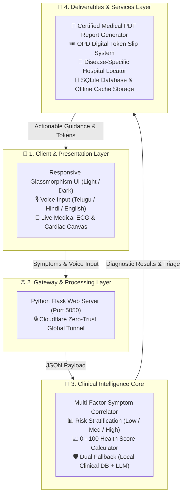
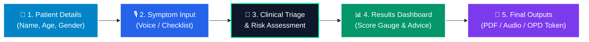

# 🩺 MediGuide AI — Project Presentation Chart

**Project Title:** MediGuide AI — Smart Clinical Diagnostic & Digital Healthcare Assistant  
**Domain:** Health Informatics • Clinical Decision Support Systems (CDSS) • Tele-Health  
**Technology Stack:** Python Flask • Progressive Web App (PWA) • Web Speech API • SQLite • Cloudflare  

---

## 📌 1. Problem Statement (Short)

* **Access Gap:** Patients frequently delay or avoid timely doctor visits due to lack of immediate health guidance, overcrowded hospital OPD queues, and geographic/rural clinic access hurdles.
* **Existing Tool Limitations:** Most online symptom checkers are complicated, English-only, text-heavy, fail completely when offline, and do not provide emergency triage or hospital appointments.
* **Our Solution:** **MediGuide AI** bridges this gap with an instant, voice-enabled, multilingual clinical triage system that evaluates symptoms, stratifies risk levels, generates certified clinical reports, and books digital OPD tokens in seconds.

---

## ⚙️ 2. Working (Step-by-Step)

```
[Patient Input] ──► [Clinical Triage] ──► [Risk & Score] ──► [Actionable Output]
```

1. **1. Input:** Patient enters basic details and speaks or selects symptoms in Telugu, Hindi, or English.
2. **2. Clinical Triage & Score:** Engine evaluates symptoms, predicts condition, assigns risk (Low/Med/High), and calculates 0-100 Health Score.
3. **3. Output & Care:** Instant voice guidance, certified A4 medical PDF report, and digital OPD token slip booking.

---

## 🏛️ 3. System Architecture Diagram (Compact)



### Visual Text Diagram (Easy for Chart Drawing / Printing):

```
┌────────────────────────────────────────────────────────┐
│         📱 1. CLIENT PRESENTATION LAYER                │
│  • Glassmorphic UI (Light & Dark Themes)               │
│  • Voice Input & Soft Audio Reader (TE / HI / EN)      │
│  • Live 60fps ECG Pulse & Floating Cardiac Canvas      │
└──────────────────────────┬─────────────────────────────┘
                           │ (Voice / Checkbox Symptoms)
                           ▼
┌────────────────────────────────────────────────────────┐
│         🌐 2. GATEWAY & PROCESSING LAYER               │
│  • Python Flask Application Server (Port 5050)         │
│  • Cloudflare Global HTTPS Tunnel & REST API Endpoints │
└──────────────────────────┬─────────────────────────────┘
                           │ (JSON Payload)
                           ▼
┌────────────────────────────────────────────────────────┐
│         🧠 3. CLINICAL INTELLIGENCE CORE               │
│  • Multi-Symptom Triage & Hallmark Pattern Matcher     │
│  • Risk Stratification Matrix (Low / Medium / High)    │
│  • AI Wellness Index Calculator (0 - 100 Gauge)        │
│  • Infallible Dual-Mode Engine (Local DB + Cloud Core) │
└──────────────────────────┬─────────────────────────────┘
                           │ (Clinical Findings & Score)
                           ▼
┌────────────────────────────────────────────────────────┐
│         📄 4. DELIVERABLES & SERVICES LAYER            │
│  • Certified Medical PDF Report (SVG Gauges & Diet)    │
│  • OPD Appointment Booking & Digital Token Slips       │
│  • Specialty Hospital Locator & Google Maps Routing    │
│  • SQLite Storage (mediguide.db) & PWA Offline Cache   │
└────────────────────────────────────────────────────────┘
```

---

## 🔄 4. Process Flowchart



### Visual Text Flowchart:

```
[1. Patient Details] ➔ [2. Voice / Checkbox Symptoms] ➔ [3. Clinical Triage] ➔ [4. Risk & Health Score] ➔ [5. PDF Report & OPD Token]
```

---

## 🏆 5. Outcomes & Results

1. **⚡ Sub-Second Clinical Triage (< 1 sec):** Evaluates multi-symptom combinations and delivers structured assessments instantly.
2. **🛡️ 100% Offline Capability:** Dual-mode local database fallback guarantees zero downtime even with zero internet connection.
3. **🌐 Universal Inclusivity:** Hands-free voice speech recognition and audio guidance in Telugu, Hindi, and English eliminate literacy and language barriers.
4. **📄 Certified Medical PDF Reports:** Vector SVG circular gauges completely eliminate rendering glitches, generating professional hospital-ready diagnostic documents.
5. **🏥 Closed-Loop Healthcare:** Bridges symptom analysis directly to physical healthcare via disease-specific hospital routing and instant digital OPD token booking.

---

## 💡 6. Viva Fast-Track Reference

* **Q1: What is MediGuide AI?**  
  *Ans:* An intelligent clinical triage and digital healthcare assistant that assesses symptoms, evaluates risk, provides medical guidance, and books hospital OPD tokens.
* **Q2: How does it work offline?**  
  *Ans:* It incorporates a dual-mode clinical intelligence engine with an infallible built-in local clinical database and PWA offline caching.
* **Q3: What makes it unique?**  
  *Ans:* Multilingual voice interaction (Telugu, Hindi, English), real-time risk stratification, certified PDF reports with SVG gauges, and integrated OPD appointment booking.
